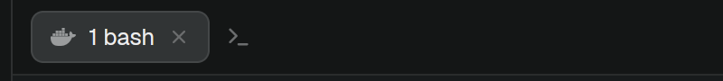

# Maestro Tabs

A [Herdr](https://herdr.dev) mod: Herdr's tab bar, plus a `>_` button right after the tabs that opens bash inside the selected space's Maestro session container. It makes a new tmux window in the container's `/workspace` and opens it as a new Herdr tab. `Ctrl+Shift+Y` does the same. When bash exits, the tab ends.

Pairs with [herdr-spaces-status](https://github.com/paneq/herdr-spaces-status), which shows what the agent in each space is doing. Neither needs the other.

## Install

Give your Herdr agent this line:

> Read ~/.config/herdr-app/AGENTS.md, then add this mod: https://github.com/paneq/herdr-maestro-tabs

Or by hand:

1. Copy `mods/tabs-maestro/` to `~/.config/herdr-app/mods/`.
2. Clone your layout if it is a shipped one (`herdr-app do layout.clone '{"name":"main","as":"my-layout"}'`), and in its JSON change the tab bar's `"mod": "tabs"` to `"mod": "tabs-maestro"`.
3. For the key, add `"ctrl-shift-y": "tabs-maestro.new-shell"` to the `global` section of `~/.config/herdr-app/keys.json`.

## What it assumes

Maestro's local Docker sessions as they are today:

- a space's folder ends in `<workspace>-<8 hex>`, the workspace Maestro made for the session;
- the container is `maestro-<workspace>-<8 hex>`, its user `vscode`;
- the session's tmux server listens on `/tmp/tmux-shared/maestro.sock`, its main session is `maestro-maestro-claude-<8 hex>`;
- each Herdr tab is a tmux session `herdr-<window>` grouped with the main one, showing that window.

In any other space the button is hidden and the key does nothing.

## What it runs

`docker exec` into the selected space's container, to run `tmux new-window` and then attach the new tab. It doesn't reach the network.

## License

Apache-2.0. `mods/tabs-maestro/main.js` is a modified copy of Herdr's shipped `tabs` mod (see `NOTICE`).
