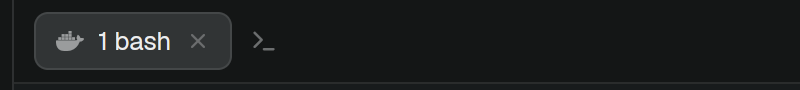

# Maestro Tabs

Herdr's tab bar, plus a button that opens bash inside the selected space's Maestro session container, as a new tab. The same action is a key command, `tabs-maestro.new-shell`, bound to `Ctrl+Shift+Y`.

## What you see

Everything the shipped `tabs` mod shows, unchanged. On top of that, in a Maestro space only: a 26px `>_` button (`icons/shell.svg`, 14px, `dim`, `hover` background) inside the tab strip, right after the last tab, moving along as tabs are added.

## How it behaves

- Click (or the key): a new tmux window running bash in `/workspace` of the space's container, then a new tab in that space named `<window index> bash`, attached to it. The new tab is selected.
- When bash exits, the tab's terminal ends. Without that, the tab's grouped tmux session would show another of the session's windows (the agent's) once its own window closed.
- Outside a Maestro space, or for a space on another machine, the button is hidden and the key does nothing.

## Built from

- A clone of the shipped `tabs` mod (`herdr-app do mod.clone '{"name":"tabs","as":"tabs-maestro"}'`), placed in a layout of your own where `tabs` was (`"content": { "mod": "tabs-maestro" }`). It has no props.
- A Maestro space: `folder` ends in `/<workspace>-<8 hex>`. Container `maestro-<workspace>-<8 hex>`, user `vscode`, tmux socket `/tmp/tmux-shared/maestro.sock`, main tmux session `maestro-maestro-claude-<8 hex>`.
- New window: `exec("docker", ["exec", "-u", "vscode", <container>, "tmux", "-S", <socket>, "new-window", "-d", "-P", "-F", "#{window_index}", "-t", "=<main>:", "-c", "/workspace", <command>])`, where `<command>` is `bash`, then `tmux kill-session -t "=herdr-<its window index>"`.
- New tab: `run("tab.new", { space, name, folder, argv })`, `argv` being `docker exec -it -u vscode <container> tmux -S <socket> -u new-session -A -t <main> -s herdr-<index> ; set-option destroy-unattached on ; set-option status off ; select-window -t :<index>`.
- Key: `init` loops on `nextCommand()` and acts on `new-shell`; `keys.json` `global` binds `"ctrl-shift-y": "tabs-maestro.new-shell"`.
- `herdr` functions: the shipped mod's, plus `exec` and `nextCommand`. Programs it runs: `docker`.

## Watch out

- Herdr's `+` menu is unchanged; this is a second button, not a replacement.
- Being a clone, it doesn't get the shipped `tabs` mod's updates.
- Tabs opened before the close-on-exit command was added keep showing another window after their shell exits; close them by hand.

## Done when

- In a Maestro space, the button shows after the last tab; elsewhere it doesn't.
- Clicking it, or `Ctrl+Shift+Y`, adds a tmux window running bash in `/workspace` and a selected tab showing it.
- `exit` in that bash ends the tab's tmux session, and the agent's window keeps running.
- `herdr-app check ~/.config/herdr-app/mods/tabs-maestro` passes.
